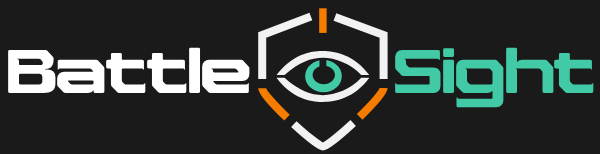

Battle Sight is an augmented reality helper for Warhammer 40k: Kill Team. A
camera above the table looks down on the board. A window on your computer
shows the live video, with extra information drawn on top of it, as if it
was on the real table.

You do not need a tape measure. The app shows the distances between your
operatives, and how far each one can move or how each shot goes. It can recognize  your operatives, track their status. It also keeps the score of the game.

The project is under development. See [docs/dev-log.md](docs/dev-log.md)
for the finished and planned features.

## Setup

You need a Mac, a camera above the board (the built-in camera for a test, or
a phone through Camo, a Wi-Fi stream, or scrcpy over USB), a printer, and
scissors.

[docs/setup.md](docs/setup.md) gives all steps:

1. Install the app.
2. Print and cut the four corner cards.
3. Put the cards and the board on the table.
4. Connect the camera.
5. Set your board and map.
6. Calibrate the lens (optional).
7. Take a photo of the empty board (for base detection).
8. Teach the app your operatives (for operative names).
9. Record your light terrain pieces (optional).
10. Change the window layout settings (optional).

## Start the app

Open the Terminal app and go to the Battle Sight folder:

```bash
uv run battlesight
```

To use another camera for one run, add `--source`, for example `--source 0`
for the built-in camera. To use only two teams, add their names:

```bash
uv run battlesight --team kommandos veterans
```

Hold the mouse pointer on a control to see its key. Push `h` to see all key
bindings. Use the menu View > Layout to change the window layout.

To zoom the video, turn the mouse wheel, or click + and - at the top right.
To move the zoomed video, hold the middle mouse button and drag. On a
trackpad, pinch to zoom and scroll with two fingers to move. Click the zoom
percentage to go back to 100%.

## Use the app

### 1. Before the game

1. Choose the terrain type and the layout card. Put the board so that corner
   card 0 is at the top-left corner of the card picture.
2. Set up the terrain and the tokens, then click "Take empty-board
   reference". This helps the app find the bases.
3. If you recorded light terrain pieces, click "Identify all terrain".
4. Choose the team of each player.
5. Remove the operatives that do not play ("Remove operative"). To add a
   copy of an operative, click "Add operative".

To add a new layout card, give a photo of the card to the AI agent (Claude
Code) and ask it to record the map.

### 2. Find the operatives

1. Put the operatives on the board.
2. Click "Identify all operatives". Check the names with a percentage or a
   `?`.
3. If a name is wrong, click the base, click "Change operative" and choose
   the correct operative. The app learns from each correction.
4. If the app found an operative where there is none, click "Remove ID".
5. If a base is not found, or an operative moved, click "Locate operative",
   then click the centre of the base. Choose the operative from the list. The
   most probable one has a grey background, and a dashed circle and an arrow
   show where it was. The app removes the base at the old place.
6. To swap two copies of the same operative, click one base, click "Change
   ID" and choose the correct copy.
7. If you use more than one model for an operative, the app finds the model
   by itself. If the model is wrong, click "Change operative" and choose the
   correct model. The app then keeps your choice. Choose "Auto model" to let
   the app find the model again.

Click "Identify all operatives" again after the operatives move or after a
change to the teams. The names stay on the live video until then. A dashed
circle and an arrow show where each moved operative was before. Check the
name of each moved operative. The arrows go when you click "Accept all
identification" or choose a name for the base.

### 3. Measure

1. Click a base to select it. Set the distance to see a range ring.
2. Right click a second base to see the distance between the two bases.

With a layout, measurements go around walls and closed hatchways. Clear
"Measure around walls" to measure in a straight line.

"Measure movement" shows where the selected operative can move. Put the
mouse pointer in the area to see the best move. Left click in the area to lock
the move. During this measurement, there is no distance to a second base. "Avoid control range" keeps
the move out of enemy control range.

"Shoot at" (with the target selected): put the mouse pointer on the shooter.
The terrain in the way shows red. Push Esc to stop.

### 4. Track the game

Click an operative to change its wounds. An operative with 0 wounds is dead.
Click a hatchway or breach point to open or close it. All start closed.

Turn, Crit Op, Tac Op, Primary, victory points and command points are in the
game bar and below each team list.
The app counts the Kill Op from the dead enemy operatives. The last Kill Op
skull is the point for more kills than the opponent.

### Save and restore the game

The app saves the game after each change. It writes the save to a new folder
`data/saves/autosave-<date>-<time>` at each app start. If the app stops,
start it again with the save:

```bash
uv run battlesight --state data/saves/autosave-20261120-201500
```

To keep the game at a moment, for example the end of a turn, click
**Save state**. The app makes a folder in `data/saves` with the turn in its
name. Restore it in the same way, with `--state` and the folder name.

### Saved photos

```bash
uv run battlesight image-pipeline my-photo.jpg --show
```

The app does the same analysis on a saved photo and shows the result. To use
an empty-board photo, add `--reference empty.jpg`. To use only some teams,
add `--team kommandos veterans`.

## What you see

- Name colour: green = sure, yellow = not sure, check it, red `?` = unknown.
- Health bar: green = unharmed, orange = wounded, red = injured.
- Skull on a base or in a team list: dead operative.
- Mint green: range ring and distance. A orange rim: a base in the range of the ring.
- Yellow lines around a hatchway: 1 in and 2 in from it.
- Yellow crossed swords: melee. Yellow arrow heads: objective control.

| Status line | Meaning | What to do |
|---|---|---|
| Yellow "locking reference" | The app learns the board position. | Do not touch the board. |
| Yellow "BOARD MOVED" | A card moved. | Keep the board still. |
| Red "CARD MOVED" | One card is not on its board corner now. | Put the card back against the board corner. |
| Red "TAG LOST" | The camera cannot see a card. | Remove what covers the card. |
| Red "camera down" | The app gets no image from the camera. | Check the camera and its cable or network. |
| Red "CORNERS NOT SEEN" | "Identify all operatives" cannot find the board. | Remove what covers the named card, or move the camera. |

## Fixing common issues

For fixes to common problems, see [docs/fixing-problems.md](docs/fixing-problems.md).
